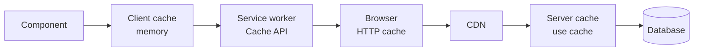
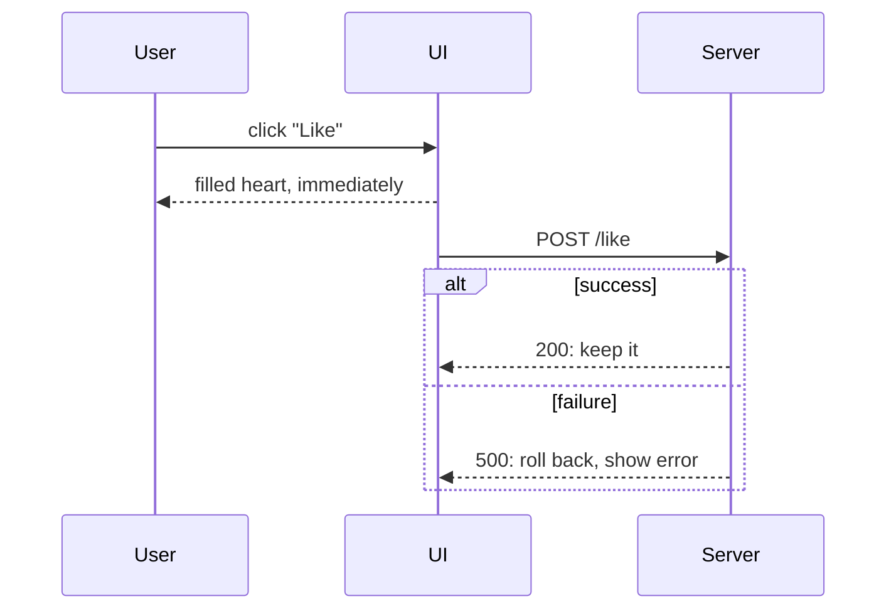
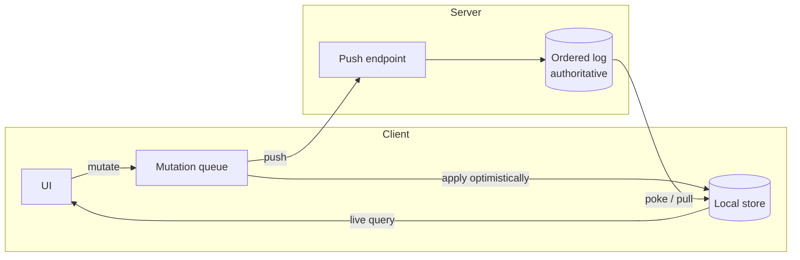

# Instant UI

## Techniques for web apps that feel instant

<div class="mt-12 text-xl muted">Cory House · github.com/coryhouse/instant-ui</div>

<!--
Welcome. Hour-long tour of 19 techniques, each with a live side-by-side demo: naive on the left, instant on the right.
Before starting: `pnpm dev` running on :3000, latency slider at default (1000ms), fail-writes OFF, Zero docker running if you'll show demo 14.
-->

---
layout: center
class: text-center
---

# Speed is a feature

<v-clicks>

Users don't experience your architecture.

They experience **waiting**.

</v-clicks>

<!--
Nobody compliments a well-factored reducer. They notice when a button takes a beat to respond.
Goal today: a toolbox for removing, moving, or hiding that wait.
-->

---

# How fast is "instant"?

<div class="grid grid-cols-3 gap-8 mt-12 text-center">
<div v-click>
  <div class="big good">0.1s</div>
  <div class="mt-4">Feels <b>instant</b>.<br/>Direct manipulation.</div>
</div>
<div v-click>
  <div class="big warn">1s</div>
  <div class="mt-4">Keeps <b>flow</b>.<br/>User notices the delay.</div>
</div>
<div v-click>
  <div class="big bad">10s</div>
  <div class="mt-4">Loses <b>attention</b>.<br/>They switch tabs.</div>
</div>
</div>

<div v-click class="mt-12 text-center muted small">Jakob Nielsen's response-time limits (based on Robert Miller, 1968)</div>

<!--
These thresholds are decades old and haven't moved, because human perception hasn't moved.
100ms: feels like cause and effect. 1s: still in flow but you notice. 10s: you've lost them.
-->

---
layout: fact
---

# <span class="big accent">400ms</span>

The **Doherty threshold**: when a system responds in under 400ms, productivity soars, because neither the user nor the computer waits on the other.

<div class="small muted mt-6">Doherty & Thadani, IBM, 1982</div>

<!--
IBM found that when response time dropped under ~400ms, people worked dramatically faster. Not linearly faster: they stayed engaged.
Takeaway: the target is not "fast enough to finish", it's "fast enough that nobody waits".
-->

---

# Core Web Vitals

| Metric | Measures | Good |
| --- | --- | --- |
| **LCP** · Largest Contentful Paint | Loading: when the main content shows | <span class="good">≤ 2.5s</span> |
| **INP** · Interaction to Next Paint | Responsiveness: click → next frame | <span class="good">≤ 200ms</span> |
| **CLS** · Cumulative Layout Shift | Stability: does stuff jump around? | <span class="good">≤ 0.1</span> |

<div v-click class="mt-10">

Measured at the **75th percentile** of real users. Google uses them for ranking.

</div>

<!--
Three numbers that map to: does it load, does it respond, does it stay put.
INP replaced FID in 2024; it measures every interaction, not just the first, so main-thread work matters all session long.
p75 of real users: your M3 MacBook on office wifi is not the p75.
-->

---

# Every technique does one of four things

<div class="grid grid-cols-2 gap-6 mt-10">
  <div v-click class="box accent"><div class="text-3xl font-bold">Do less</div><div class="small mt-2">ship less code, render fewer nodes, skip repeated work</div></div>
  <div v-click class="box accent"><div class="text-3xl font-bold">Do it earlier</div><div class="small mt-2">build time, prefetch, cache, before the click</div></div>
  <div v-click class="box accent"><div class="text-3xl font-bold">Do it elsewhere</div><div class="small mt-2">CDN, server, service worker, web worker, local DB</div></div>
  <div v-click class="box accent"><div class="text-3xl font-bold">Hide the wait</div><div class="small mt-2">stream, skeletons, optimistic UI, transitions</div></div>
</div>

<!--
This is the mental model for the whole talk. When you see a technique, ask: which of the four is it?
Most of the best ones combine two. Optimistic UI = hide the wait + do it elsewhere (later).
-->

---

# The plan: 19 demos, 6 sections

<div class="grid grid-cols-2 gap-x-12 gap-y-4 mt-8">

<div><b class="accent">1 · Render less, earlier</b><br/><span class="small">static · PPR · streaming</span></div>
<div><b class="accent">2 · Ship less</b><br/><span class="small">lazy loading · images · prefetch</span></div>
<div><b class="accent">3 · Cache everything</b><br/><span class="small">client · server · HTTP · service worker</span></div>
<div><b class="accent">4 · Don't wait for the server</b><br/><span class="small">optimistic · local-first · sync engines</span></div>
<div><b class="accent">5 · Keep the main thread free</b><br/><span class="small">memo · transitions · virtualization · workers</span></div>
<div><b class="accent">6 · Feel faster</b><br/><span class="small">view transitions</span></div>

</div>

<!--
Roughly in the order a request flows: server rendering, then what we ship, then caching, then mutations, then the main thread, then perception.
-->

---

# How the demos work

<v-clicks>

- Every demo: **Naive** on the left, **Instant** on the right
- **Latency slider** in the header: simulated server delay (default 1000ms)
- **Fail 50% of writes** toggle: test rollbacks and retries
- Timing badges show *time to feedback*, not just time to done
- Page-load demos: **Reload both** reloads two iframes at once

</v-clicks>

<div v-click class="mt-8"><DemoLink slug="" /></div>

<!--
Show the home page quickly. Point out the latency slider and fail toggle in the header.
Everything runs locally and offline. The latency is fake but realistic: it's what your p75 mobile user lives with.
-->

---
layout: section
---

# 1 · Render less, earlier

<div class="muted">Static · Partial prerendering · Streaming</div>

<!--
First section: what happens on the server before the first byte, and how to start sending bytes sooner.
-->

---

# Static rendering

**Problem:** rendering the same HTML for every request. Every user pays for server work and DB calls.

```tsx {1|3-6|8-10|all}
import { cacheLife } from "next/cache";

export default async function Pricing() {
  "use cache";            // render once, reuse for everyone
  cacheLife("hours");     // ...and refresh in the background
  const plans = await getPlans();

  return <PlanTable plans={plans} />;
}
// Built at `next build` → served as a file from the CDN
```

<!--
Do it earlier: at build time. With Cache Components, "use cache" makes the output static; uncached data makes it dynamic.
cacheLife decides how stale it can get. The fastest server is no server.
-->

---

# Demo: static rendering

<div class="grid grid-cols-2 gap-10 mt-6">
<div>
  <DemoLink slug="static" :n="1" />
  <div class="small mt-6 muted">Dynamic SSR vs prerendered, side by side.</div>
</div>
<div class="not-for">

**When not to**

- Per-user content (cart, dashboard)
- Data that must be fresh to the second
- Huge page counts: generate on demand instead

</div>
</div>

<!--
DEMO CUE: set latency to 2000ms, click "Reload both".
Point at "Rendered at": the static page doesn't change, the dynamic one does every reload.
Note: dev mode renders everything on demand; for real numbers run `pnpm build && pnpm start`.
-->

---

# Partial prerendering

**Problem:** one personalized widget makes the *whole page* dynamic.

<div class="grid grid-cols-3 gap-4 mt-10 text-center">
  <div class="box good col-span-3">Header · nav · layout <span class="small muted">(static shell, from CDN)</span></div>
  <div class="box good">Product info</div>
  <div class="box bad" v-click>Cart count<br/><span class="small">streams in</span></div>
  <div class="box bad" v-click>Recommendations<br/><span class="small">streams in</span></div>
</div>

<div v-click class="mt-10 text-center">The shell ships <b>instantly</b>. Dynamic holes stream into the same response.</div>

<!--
PPR = static and dynamic in one route. The prerendered shell goes out immediately, Suspense boundaries mark the holes, and the server fills them in over the same HTTP response.
In Next 16 with cacheComponents, this is just the default model.
-->

---

# PPR: the code is just Suspense

```tsx {3-4|5-7|8-10|all}
export default function ProductPage() {
  return (
    <>
      <ProductInfo />                {/* "use cache" → in the shell */}
      <Suspense fallback={<CartSkeleton />}>
        <CartCount />                {/* reads cookies → dynamic hole */}
      </Suspense>
      <Suspense fallback={<RecsSkeleton />}>
        <Recommendations />          {/* uncached fetch → dynamic hole */}
      </Suspense>
    </>
  );
}
```

<div v-click class="mt-6 small">The <code>&lt;Suspense&gt;</code> boundary <i>is</i> the line between static and dynamic.</div>

<!--
No special API. The Suspense boundary decides where the static shell ends.
Anything cached or pure goes in the shell; anything that touches cookies, headers, or uncached data becomes a hole.
-->

---

# Demo: partial prerendering

<div class="grid grid-cols-2 gap-10 mt-6">
<div>
  <DemoLink slug="ppr" :n="2" />
  <div class="small mt-6 muted">Fully dynamic page vs static shell + streamed holes.</div>
</div>
<div class="not-for">

**Watch out for**

- Skeletons that shift layout (CLS!)
- Too many tiny holes = popcorn UI
- Shell must be meaningful, not just a spinner

</div>
</div>

<!--
DEMO CUE: latency 2000ms, "Reload both". Compare the "shell" mark: instant shows the shell right away, naive shows nothing until everything is done.
Then compare "content": roughly the same. Same total work, much better perceived speed.
-->

---

# Streaming: kill the waterfall

<div class="grid grid-cols-2 gap-10 mt-6">
<div>

**Naive:** sequential awaits

```mermaid {scale: 0.7}
gantt
  dateFormat X
  axisFormat %s
  section Request
  product   :0, 1
  reviews   :1, 2
  recs      :2, 3
  render    :3, 4
```



</div>
<div v-click>

**Instant:** parallel + stream

```mermaid {scale: 0.7}
gantt
  dateFormat X
  axisFormat %s
  section Request
  shell     :0, 1
  product   :0, 1
  reviews   :0, 1
  recs      :0, 1
```



</div>
</div>

<!--
Waterfalls are the #1 server-side perf bug I see. Each await waits for the previous one even when they're independent.
Fix: start everything at once, and stream each piece as it resolves.
-->

---

# Streaming: the code

```tsx {1-6|8-16|all}
// Naive: waterfall: 3 round trips, nothing shows until all finish
async function Page({ id }) {
  const product = await getProduct(id);
  const reviews = await getReviews(id);
  const recs = await getRecommendations(id);
  return <Layout product={product} reviews={reviews} recs={recs} />;
}

// Instant: parallel + streamed: each section reveals when ready
function Page({ id }) {
  return (
    <Layout>
      <Suspense fallback={<Skel />}><Product id={id} /></Suspense>
      <Suspense fallback={<Skel />}><Reviews id={id} /></Suspense>
      <Suspense fallback={<Skel />}><Recs id={id} /></Suspense>
    </Layout>
  );
}
```

<!--
Each child component fetches its own data. Siblings under separate Suspense boundaries render in parallel.
If you need all the data in one place, `Promise.all` at least removes the waterfall.
-->

---

# Demo: streaming & Suspense

<div class="grid grid-cols-2 gap-10 mt-6">
<div>
  <DemoLink slug="streaming" :n="3" />
  <div class="small mt-6 muted">Sequential awaits vs parallel Suspense boundaries.</div>
</div>
<div class="not-for">

**Watch out for**

- Nested Suspense inside a fetching parent re-creates the waterfall
- Reveal order: use `<SuspenseList>`-style grouping or coarser boundaries
- Status code is sent before holes resolve

</div>
</div>

<!--
DEMO CUE: latency 1000ms. Reload both. Naive: ~3s blank, then everything. Instant: shell immediately, sections pop in at ~1s.
Point out total time drops from 3x latency to 1x latency.
-->

---
layout: section
---

# 2 · Ship less

<div class="muted">Lazy loading · Images · Prefetch</div>

<!--
Now the client side. The bytes you send, and when you send them.
-->

---

# Lazy loading

**Problem:** the chart library, the rich text editor, the admin modal: all in the first bundle, for every user.

```tsx {1-4|6-11|all}
// Split it out: downloaded only when rendered
const Chart = dynamic(() => import("./Chart"), {
  loading: () => <ChartSkeleton />,
});

function Dashboard() {
  const [show, setShow] = useState(false);
  return show
    ? <Chart />
    : <button onClick={() => setShow(true)}>Show chart</button>;
}
```

<div v-click class="small mt-4">Plain React: <code>React.lazy(() =&gt; import("./Chart"))</code> + <code>&lt;Suspense&gt;</code></div>

<!--
Do less (up front). Every KB of JS has to be downloaded, parsed, compiled, executed: that's main-thread time before the page is interactive.
Server Components already ship zero JS; lazy loading is for the client components you do need, eventually.
-->

---

# Demo: lazy loading

<div class="grid grid-cols-2 gap-10 mt-6">
<div>
  <DemoLink slug="lazy" :n="4" />
  <div class="small mt-6 muted">Eager import vs dynamic import on demand.</div>
</div>
<div class="not-for">

**When not to**

- Above-the-fold or always-used components
- Tiny components: the extra request costs more
- Fix the lag: preload on hover / intent

</div>
</div>

<!--
DEMO CUE: open DevTools Network tab, filter JS. Load the page: naive downloads the heavy chunk immediately. Instant only downloads when you click.
Mention: preload on hover to hide the delay of the lazy chunk itself.
-->

---

# Image optimization

**Problem:** images are usually the LCP element *and* the biggest bytes.

```tsx {2|3|4|5|all}
<Image
  src={hero}                 // static import → width/height known: no CLS
  sizes="(max-width: 768px) 100vw, 50vw"  // right size per viewport
  preload                    // LCP image: fetch it first
  placeholder="blur"         // something to look at immediately
  alt="Hero"
/>
// Below the fold: lazy by default. Served as AVIF/WebP.
```

<!--
Right size, right format, right priority.
In Next 16, `priority` is deprecated in favor of `preload` (or fetchPriority="high").
Everything below the fold is loading="lazy" by default.
-->

---

# Demo: image optimization

<div class="grid grid-cols-2 gap-10 mt-6">
<div>
  <DemoLink slug="images" :n="5" />
  <div class="small mt-6 muted">Raw &lt;img&gt; vs sized, prioritized, modern-format images.</div>
</div>
<div class="not-for">

**Watch out for**

- Don't preload more than the 1–2 LCP images
- Never lazy-load the LCP image
- Optimization costs CPU: cache it or use a CDN loader

</div>
</div>

<!--
DEMO CUE: Network tab, sort by size. Naive downloads the multi-MB originals; instant serves a fraction.
Watch for layout shift on naive as images pop in without dimensions.
-->

---

# Prefetch & preload

**Start the work before the click.**

```tsx {1-2|4-8|10-12|all}
// Next <Link>: prefetches the route when it enters the viewport (prod)
<Link href="/products/42">Widget</Link>

// Prefetch on intent: hover / focus ≈ 100–300ms head start
<Link href="/products/42" prefetch={false}
  onMouseEnter={() => router.prefetch("/products/42")}>
  Widget
</Link>

// React 19 resource hints from any component
preconnect("https://api.example.com");
preload("/fonts/inter.woff2", { as: "font" });
```

<!--
Do it earlier. The gap between hover and click is often 200ms+: free time.
Viewport prefetch for a few links; intent prefetch for long lists. React 19's preload/preconnect/prefetchDNS let any component emit hints.
-->

---

# Demo: prefetch & preload

<div class="grid grid-cols-2 gap-10 mt-6">
<div>
  <DemoLink slug="prefetch" :n="6" />
  <div class="small mt-6 muted">No prefetch vs viewport/intent prefetch.</div>
</div>
<div class="not-for">

**Watch out for**

- Wasted bandwidth/server load on links nobody clicks
- Prefetching per-user data that goes stale
- Respect `Save-Data` / slow connections

</div>
</div>

<!--
DEMO CUE: prefetching only happens in production. Run `pnpm build && pnpm start` before the talk for this one.
Hover a link on the instant side, then click: page appears immediately. Naive side waits full latency.
-->

---
layout: section
---

# 3 · Cache everything

<div class="muted">Client · Server · HTTP · Service worker</div>

<!--
The fastest request is the one you don't make.
-->

---

# Caches all the way down



<v-click>

Each layer you hit **closer to the left** saves a round trip. We'll demo four of them.

</v-click>

<!--
Every arrow is latency. Each cache layer short-circuits everything to its right.
We'll go left to right in importance for UX: client, then server, then HTTP, then service worker.
-->

---

# Client cache: stale-while-revalidate

```tsx {1-5|7-8|all}
const { data, isFetching } = useQuery({
  queryKey: ["products"],
  queryFn: fetchProducts,
  staleTime: 30_000,     // fresh for 30s: no refetch at all
});

// Navigate away and back → cached data renders immediately,
// then refetches in the background if stale.
```

<div v-click class="mt-6">

**Show cached data now. Fix it up when the network answers.**

</div>

<!--
TanStack Query v5 (or SWR). The cache is keyed by queryKey; revisiting a screen renders from cache synchronously, no spinner.
isFetching lets you show a subtle "updating" indicator instead of a skeleton. Can persist to localStorage for instant cold starts.
-->

---

# Demo: client cache (SWR)

<div class="grid grid-cols-2 gap-10 mt-6">
<div>
  <DemoLink slug="caching/client" :n="7" />
  <div class="small mt-6 muted">useEffect + fetch vs TanStack Query cache.</div>
</div>
<div class="not-for">

**When not to**

- Data where stale is dangerous (balances, inventory at checkout)
- Highly personalized data on shared devices
- Remember: invalidate after mutations

</div>
</div>

<!--
DEMO CUE: latency 2000ms. Switch between tabs/products a few times. Naive shows a spinner every time; instant is immediate after the first visit, with a background "refreshing" hint.
-->

---

# Server cache: `use cache` + tags

```ts {1-6|8-13|all}
async function getProducts() {
  "use cache";
  cacheTag("products");     // label this entry
  cacheLife("days");
  return db.products.findMany();   // slow query runs once
}

async function updatePrice(id: string, price: number) {
  "use server";
  await db.products.update(id, { price });
  updateTag("products");    // purge exactly what changed
}
```

<!--
Compute once, invalidate precisely. "use cache" works on functions and components, not just pages.
updateTag in a Server Action gives read-your-own-writes: the user sees the change immediately. revalidateTag(tag, "max") elsewhere for stale-while-revalidate semantics.
-->

---

# Demo: server cache

<div class="grid grid-cols-2 gap-10 mt-6">
<div>
  <DemoLink slug="caching/server" :n="8" />
  <div class="small mt-6 muted">Uncached query per request vs tagged cache + precise invalidation.</div>
</div>
<div class="not-for">

**Watch out for**

- Never cache per-user data under a shared key
- Forgetting to tag = stale forever
- Cache stampede when a hot entry expires

</div>
</div>

<!--
DEMO CUE: latency 2000ms. Reload a few times: naive is 2s every time, instant is 2s once then immediate.
Then edit an item: instant invalidates the tag and shows fresh data right away.
-->

---

# HTTP cache

```ts {1-3|5-9|all}
// Browser caches it, CDN shares it, nobody re-asks for 60s
return Response.json(data, {
  headers: {
    "Cache-Control":
      "public, max-age=60, stale-while-revalidate=600",
  },
});

// Fingerprinted assets (app.3f9a.js): cache forever
// Cache-Control: public, max-age=31536000, immutable
```

<v-click>

`max-age`: fresh, zero requests · `stale-while-revalidate`: serve stale, refresh in background · `ETag`: cheap 304 check

</v-click>

<!--
The oldest cache and still the best. Zero JavaScript. Works for every client.
max-age = no request at all. SWR = respond instantly from cache while refetching. ETag/If-None-Match = still a round trip but no body.
-->

---

# Demo: HTTP cache

<div class="grid grid-cols-2 gap-10 mt-6">
<div>
  <DemoLink slug="caching/http" :n="9" />
  <div class="small mt-6 muted"><code>no-store</code> vs <code>max-age</code> + <code>stale-while-revalidate</code>.</div>
</div>
<div class="not-for">

**Watch out for**

- You can't purge a browser cache: keep max-age short for HTML/APIs
- `public` on per-user responses leaks data via CDNs
- Use `private` or `Vary` correctly

</div>
</div>

<!--
DEMO CUE: Network tab open, "Disable cache" OFF. Fetch repeatedly: naive hits the server every time (full latency), instant shows "(disk cache)" / "(memory cache)" with 0ms.
-->

---

# Service worker cache

A programmable proxy that lives in the browser.

```js {1-2|3-11|all}
// sw.js
self.addEventListener("fetch", (event) => {
  event.respondWith(
    caches.open("v1").then(async (cache) => {
      const cached = await cache.match(event.request);
      const network = fetch(event.request).then((res) => {
        cache.put(event.request, res.clone());
        return res;
      });
      return cached ?? network;   // stale-while-revalidate, offline-capable
    })
  );
});
```

<!--
Do it elsewhere: in a separate thread that intercepts every request from the page.
Cache-first for the app shell = instant repeat loads and offline support. This is what makes a PWA work.
-->

---

# Demo: service worker cache

<div class="grid grid-cols-2 gap-10 mt-6">
<div>
  <DemoLink slug="caching/sw" :n="10" />
  <div class="small mt-6 muted">Network-only vs service-worker-cached. Try going offline.</div>
</div>
<div class="not-for">

**Watch out for**

- Updates: users can be stuck on an old version
- Debugging is hard (DevTools → Application → Service Workers)
- Consider Workbox / Serwist instead of hand-rolling

</div>
</div>

<!--
DEMO CUE: load once, then DevTools → Network → Offline. Reload: naive breaks, instant still works from the SW cache.
Remember to turn offline back OFF afterward!
-->

---
layout: section
---

# 4 · Don't wait for the server

<div class="muted">Optimistic UI · Local-first · Sync engines</div>

<!--
Everything so far was about reads. Now writes. This is where apps like Linear feel magical.
-->

---

# Optimistic UI



<!--
Hide the wait. Assume success, because 99% of writes do succeed, show it now, reconcile when the server answers.
The important part is the failure path: roll back and tell the user.
-->

---

# Optimistic UI: `useOptimistic`

```tsx {1-4|6-11|13|all}
const [optimisticTodos, addOptimistic] = useOptimistic(
  todos,
  (state, newTodo) => [...state, { ...newTodo, pending: true }],
);

async function add(formData: FormData) {
  const todo = { id: crypto.randomUUID(), text: formData.get("text") };
  addOptimistic(todo);        // shows now
  await addTodo(todo);        // server action; may throw
  // when the action settles, optimistic state is discarded → real state
}

return <form action={add}>…{optimisticTodos.map(renderTodo)}</form>;
```

<!--
React 19's useOptimistic: optimistic state lives only for the duration of the transition/action. When it ends, React falls back to the real state, so rollback on error is automatic.
TanStack Query has the same pattern with onMutate/onError.
-->

---

# Demo: optimistic UI

<div class="grid grid-cols-2 gap-10 mt-6">
<div>
  <DemoLink slug="optimistic" :n="11" />
  <div class="small mt-6 muted">Wait-for-server vs useOptimistic with rollback.</div>
</div>
<div class="not-for">

**When not to**

- Payments, irreversible or high-stakes actions
- Writes that fail often (validation-heavy)
- Server-generated values the UI depends on

</div>
</div>

<!--
DEMO CUE: latency 2000ms. Add a todo on each side: naive waits 2s, instant is immediate (timing badge ~0ms).
Then turn ON "Fail 50% of writes" and add several: watch the instant side roll back and show an error. Turn it OFF afterward.
-->

---

# Local-first

**Flip it:** the local database is the source of truth. The network is a sync detail.

```tsx {1-4|6-8|10|all}
const db = new Dexie("app");
db.version(1).stores({ todos: "id, done, createdAt" });

// Reads: a live query over IndexedDB. Re-renders on change.
const todos = useLiveQuery(() =>
  db.todos.orderBy("createdAt").toArray());

// Writes: local, ~1ms. Sync to the server in the background.
await db.todos.add({ id, text, done: false, createdAt: Date.now() });
```

<!--
Optimistic UI is a patch over a server-first model. Local-first removes the server from the critical path for both reads AND writes.
Works offline, survives reload, every interaction is local speed.
-->

---

# Demo: local-first

<div class="grid grid-cols-2 gap-10 mt-6">
<div>
  <DemoLink slug="local-first" :n="12" />
  <div class="small mt-6 muted">Server round trip per action vs IndexedDB + background sync.</div>
</div>
<div class="not-for">

**The hard parts**

- Initial load: how much data do you sync down?
- Conflicts, auth, permissions, schema migrations
- That's why sync engines exist →

</div>
</div>

<!--
DEMO CUE: latency 2000ms. Add/toggle items: instant side is immediate. Reload the page: data is still there instantly (from IndexedDB).
Go offline (DevTools), keep editing, come back online: it syncs.
-->

---

# How a sync engine works



<v-clicks>

1. Mutations apply locally **and** go into a queue
2. Server applies them in order → authoritative **log**
3. Clients pull new log entries, **rebase** pending local mutations on top

</v-clicks>

<!--
This is the architecture behind Linear, Figma, Replicache, Zero.
Rebase is the key idea: like git. Take the server state, re-apply my unconfirmed mutations on top. If the server rejected one, it simply disappears.
-->

---

# Rebase, by hand

```ts {1-5|7-14|all}
type Mutation = { id: string; name: "addTodo" | "toggle"; args: unknown };

let confirmed: State;          // last state from the server
let pending: Mutation[] = [];  // sent, not yet acknowledged
const view = () => pending.reduce(apply, confirmed);

// Server pushed new state (includes all mutations it accepted)
function onServerUpdate(state: State, lastAckedId: string) {
  confirmed = state;
  pending = pending.slice(
    pending.findIndex((m) => m.id === lastAckedId) + 1,
  );
  render(view());   // my unacked edits stay on top
}
```

<!--
The whole trick in ~15 lines. The view is always "server truth + my pending mutations replayed".
Server-side, the mutator is authoritative: it can reject, or produce a different result, and clients converge.
-->

---

# Demo: hand-rolled sync engine

<div class="grid grid-cols-2 gap-10 mt-6">
<div>
  <DemoLink slug="sync/hand-rolled" :n="13" />
  <div class="small mt-6 muted">Mutation queue + server log + push. Open two windows.</div>
</div>
<div class="not-for">

**Why not hand-roll in prod**

- Partial sync, permissions, reconnection
- Schema changes, garbage-collecting the log
- Months of edge cases

</div>
</div>

<!--
DEMO CUE: open the demo in TWO browser windows side by side. Latency 1000ms.
Add/toggle in window A: immediate locally, appears in window B after push. Show the pending queue draining.
Turn ON fail writes: rejected mutations vanish on rebase. Turn it OFF afterward.
-->

---

# Production sync: Zero

```ts {1-6|8-12|14-16|all}
// Queries run against the local replica: instant, reactive
const [issues] = useQuery(
  z.query.issue
    .where("status", "open")
    .related("assignee")
    .orderBy("modified", "desc"),
);

// Mutators run on client (optimistic) AND server (authoritative)
const mutators = defineMutators({
  issue: { close: defineMutator(({ tx, args }) =>
    tx.mutate.issue.update({ id: args.id, status: "closed" })) },
});

// zero-cache replicates Postgres → clients (logical replication)
// Only the rows your queries need are synced
```

<!--
Rocicorp Zero: Postgres is the source of truth, zero-cache sits in between, clients hold a partial replica.
Queries are written once and run both locally (instant) and on the server (for sync). Permissions enforced server-side.
-->

---

# Demo: Zero

<div class="grid grid-cols-2 gap-10 mt-6">
<div>
  <DemoLink slug="sync/zero" :n="14" />
  <div class="small mt-6 muted">Postgres + zero-cache. Two windows, zero spinners.</div>
</div>
<div class="not-for">

**Tradeoffs**

- Another service to run (zero-cache)
- Postgres-only, logical replication required
- Data model must fit "partial replica" thinking

</div>
</div>

<!--
DEMO CUE: requires Docker: `pnpm zero:up` and `pnpm zero:cache` running BEFORE the talk (see README).
Two windows. Edit in one: instant locally, appears in the other in milliseconds. Bump the latency slider: local UI is unaffected.
-->

---

# The sync engine landscape

| Tool | Source of truth | Model | Notes |
| --- | --- | --- | --- |
| **Zero** | Postgres | Partial replica + ZQL | Queries run locally and on server |
| **ElectricSQL** | Postgres | Read-path sync (shapes) | Bring your own writes |
| **InstantDB** | Hosted | Relational + realtime | Firebase-like DX |
| **Convex** | Hosted | Reactive server functions | Server-first, live queries |
| **Replicache** | Your backend | Push/pull + rebase | Zero's predecessor; now open source |
| **TanStack DB** | Your API | Client collections + optimistic | Pairs with TanStack Query |
| **Yjs / Automerge** | Peers | CRDTs | Collaborative text, offline merge |

<!--
Two broad families: server-authoritative with rebase (Zero, Replicache, Convex, Instant) vs CRDTs (Yjs, Automerge) which merge without a central authority, great for collaborative documents.
Pick based on: where your data lives today, and whether you need offline multi-writer merges.
-->

---

# When is sync worth it?

<div class="grid grid-cols-2 gap-10 mt-8">
<div>

**Great fit**

- Highly interactive, data-heavy apps
- Collaboration / multi-device
- Offline or flaky networks
- Productivity tools (think Linear)

</div>
<div class="not-for">

**Poor fit**

- Content sites, mostly-read pages
- Huge or highly sensitive datasets
- Simple CRUD with rare writes
- Teams without appetite for new infra

</div>
</div>

<!--
Sync engines are the biggest lever in this talk but also the biggest commitment. Optimistic UI gets you 80% for simple forms.
-->

---
layout: section
---

# 5 · Keep the main thread free

<div class="muted">Memoization · Transitions · Virtualization · Web workers</div>

<!--
INP territory. One main thread runs your JS, layout, paint, and input handling. A 300ms task means a 300ms frozen UI.
-->

---

# Memoization

**Problem:** a parent re-render re-runs every expensive child.

```tsx {1-3|5-7|9-10|all}
// Skip recomputing when inputs haven't changed
const sorted = useMemo(() => sortBig(rows, sortKey), [rows, sortKey]);
const onSelect = useCallback((id) => setSelected(id), []);

// Skip re-rendering when props haven't changed
const Row = memo(function Row({ row, onSelect }) { … });

// Or: React Compiler does all of the above automatically
// next.config.ts → reactCompiler: true
```

<!--
Do less: skip work you've already done.
The React Compiler (1.0) auto-memoizes components and values. This repo has it on, so the "naive" demo opts out with "use no memo".
-->

---

# Demo: memoization

<div class="grid grid-cols-2 gap-10 mt-6">
<div>
  <DemoLink slug="memo" :n="15" />
  <div class="small mt-6 muted">Re-render everything vs memoized / compiled.</div>
</div>
<div class="not-for">

**Watch out for**

- Memo has a cost: compare + memory
- Unstable props (inline objects) defeat it
- Profile first: React DevTools → "Highlight updates"

</div>
</div>

<!--
DEMO CUE: type in the input. Watch the render counters: naive re-renders every row on each keystroke; instant re-renders only what changed.
-->

---

# Transitions

**Problem:** an expensive update blocks typing.

```tsx {1-6|8-11|all}
// Urgent: the input. Non-urgent: the filtered list.
const [isPending, startTransition] = useTransition();
function onChange(e) {
  setQuery(e.target.value);                         // urgent
  startTransition(() => setFilter(e.target.value)); // interruptible
}

// Or: defer a value you don't own
const deferredQuery = useDeferredValue(query);
const results = <SlowList query={deferredQuery} />;
// stale UI while rendering; new keystroke abandons the old render
```

<!--
Hide the wait / keep responsive. Transitions let React interrupt a slow render when new input arrives.
The input stays at 60fps; the list catches up. isPending lets you dim the stale content.
Note: this only helps with React rendering work, not with a single long synchronous computation.
-->

---

# Demo: transitions

<div class="grid grid-cols-2 gap-10 mt-6">
<div>
  <DemoLink slug="transitions" :n="16" />
  <div class="small mt-6 muted">Blocking update vs useTransition / useDeferredValue.</div>
</div>
<div class="not-for">

**Not a fix for**

- Slow non-React code (one long loop) → workers
- Too many DOM nodes → virtualization
- Controlled inputs: never put input state in a transition

</div>
</div>

<!--
DEMO CUE: type quickly in both inputs. Naive input stutters and drops characters; instant input stays smooth while the list lags slightly behind.
Optional: DevTools CPU throttling 4x to exaggerate.
-->

---

# Virtualization

<div class="grid grid-cols-2 gap-10">
<div>

```tsx {1-5|7-12|all}
const v = useVirtualizer({
  count: 10_000,
  getScrollElement: () => ref.current,
  estimateSize: () => 36,
});

<div style={{ height: v.getTotalSize() }}>
  {v.getVirtualItems().map((item) => (
    <Row key={item.key} index={item.index}
      style={{ transform: `translateY(${item.start}px)` }} />
  ))}
</div>
```

</div>
<div v-click>

**10,000 rows → ~20 DOM nodes**

Render only what's on screen, plus a small overscan.

<div class="small muted mt-4"><code>@tanstack/react-virtual</code>, or CSS <code>content-visibility: auto</code> for simpler cases</div>

</div>
</div>

<!--
Do less: fewer DOM nodes means faster render, layout, memory.
The virtualizer computes which rows are visible from scroll position and absolutely positions just those.
-->

---

# Demo: virtualization

<div class="grid grid-cols-2 gap-10 mt-6">
<div>
  <DemoLink slug="virtualization" :n="17" />
  <div class="small mt-6 muted">Render 10k rows vs virtualized list.</div>
</div>
<div class="not-for">

**Watch out for**

- Ctrl+F can't find off-screen rows
- Accessibility & SEO: content isn't in the DOM
- Variable heights need measuring

</div>
</div>

<!--
DEMO CUE: watch the initial render time and the DOM node count. Scroll fast: naive janks, instant stays smooth. Open Elements panel to show how few rows exist.
-->

---

# Web workers

**Problem:** a 500ms computation freezes everything. INP fails.

```ts {1-6|8-12|all}
// worker.ts: runs on another thread
self.onmessage = (e: MessageEvent<number[]>) => {
  const result = heavyCompute(e.data);   // blocks *this* thread only
  self.postMessage(result);
};

// component
const worker = useMemo(
  () => new Worker(new URL("./worker.ts", import.meta.url)), []);
worker.onmessage = (e) => setResult(e.data);
worker.postMessage(data);              // UI stays responsive
```

<!--
Do it elsewhere. Parsing, image processing, search indexing, diffing big data: none of it needs the DOM.
Comlink makes the message-passing feel like async function calls.
-->

---

# Demo: web workers

<div class="grid grid-cols-2 gap-10 mt-6">
<div>
  <DemoLink slug="workers" :n="18" />
  <div class="small mt-6 muted">Main-thread compute vs worker. Watch the spinner.</div>
</div>
<div class="not-for">

**Watch out for**

- Data is copied (structured clone): big payloads cost
- No DOM access
- Overkill for &lt;50ms tasks

</div>
</div>

<!--
DEMO CUE: click "Compute" on each side and try typing / watch the animation. Naive: animation freezes, input dead. Instant: everything stays smooth.
-->

---
layout: section
---

# 6 · Feel faster

<div class="muted">View transitions</div>

<!--
Last technique is about perception: making change feel connected instead of jarring.
-->

---

# View transitions

```tsx {1|3-8|10-12|all}
import { ViewTransition } from "react";

// List page
<Link href={`/products/${p.id}`}>
  <ViewTransition name={`product-${p.id}`}>
    <Image src={p.image} alt={p.name} />
  </ViewTransition>
</Link>

// Detail page: same name → the browser morphs one into the other
<ViewTransition name={`product-${p.id}`}>
  <Image src={p.image} alt={p.name} />
</ViewTransition>
```

<div v-click class="small mt-4">Activates on transitions: <code>startTransition</code>, <code>&lt;Link&gt;</code> navigations, Suspense reveals.</div>

<!--
Hide the wait / continuity. The View Transitions API snapshots old and new states and animates between them on the compositor.
React's <ViewTransition> wires it to transitions. A shared element morph makes navigation feel like one continuous thing, not a page swap.
-->

---

# Demo: view transitions

<div class="grid grid-cols-2 gap-10 mt-6">
<div>
  <DemoLink slug="view-transitions" :n="19" />
  <div class="small mt-6 muted">Hard cut vs animated continuity.</div>
</div>
<div class="not-for">

**Watch out for**

- Keep it short: 150–300ms
- Respect `prefers-reduced-motion`
- Animation doesn't fix a slow page: it decorates a fast one

</div>
</div>

<!--
DEMO CUE: click a product on each side. Naive: instant hard cut. Instant: the image morphs into place.
Ask the audience which one "felt" faster. Usually the animated one, even though it's technically the same speed.
-->

---

# Bottleneck → technique

| If the bottleneck is… | Reach for |
| --- | --- |
| Slow server / data | Static, server cache, streaming, PPR |
| Big bundle | Lazy loading, Server Components |
| Heavy images / LCP | Image optimization, preload |
| Slow network | Prefetch, HTTP cache, service worker |
| Repeat visits | Client cache (SWR), HTTP cache, SW |
| Slow mutations | Optimistic UI → local-first → sync engine |
| Janky interactions | Transitions, memo, virtualization, workers |
| Abrupt changes | Skeletons, view transitions |

<!--
Print this slide. Diagnose first, then pick the matching technique. Applying them all blindly just adds complexity.
-->

---

# Measure first

<div class="grid grid-cols-2 gap-10 mt-8">
<div>

**Lab**

- **Lighthouse**: LCP, CLS, bundle hints
- **Performance panel**: long tasks, waterfalls, INP
- **React DevTools Profiler**: why did this render?
- **Network panel**: throttling, cache hits

</div>
<div v-click>

**Field (what users really feel)**

- `web-vitals` library → your analytics
- Chrome UX Report (CrUX), Search Console
- Next.js `useReportWebVitals`
- Always look at **p75**, on **mobile**

</div>
</div>

<!--
Lab tools tell you why; field data tells you whether it matters. Throttle CPU and network in DevTools: your laptop lies to you.
-->

---
layout: center
class: text-center
---

# Do less · Do it earlier · Do it elsewhere · Hide the wait

<div v-click class="mt-10 text-2xl">

The best UI isn't fast. It's **instant**: the user never waits on you.

</div>

<!--
Recap the four moves. Every one of the 19 demos was one or two of these.
-->

---

# Resources

- **Demos & slides:** [github.com/coryhouse/instant-ui](https://github.com/coryhouse/instant-ui)
- Next.js Cache Components, PPR, streaming: [nextjs.org/docs](https://nextjs.org/docs)
- React: [react.dev](https://react.dev) (useOptimistic, useTransition, ViewTransition)
- Core Web Vitals: [web.dev/vitals](https://web.dev/vitals)
- TanStack Query & Virtual: [tanstack.com](https://tanstack.com)
- Local-first: [localfirstweb.dev](https://localfirstweb.dev) · Zero: [zero.rocicorp.dev](https://zero.rocicorp.dev)
- Dexie: [dexie.org](https://dexie.org)

<!--
Everything you saw today is in the repo, including these slides. Clone it, move the latency slider, break things.
-->

---
layout: end
---

# Thank you!

Cory House · github.com/coryhouse/instant-ui

<!--
Questions.
-->
