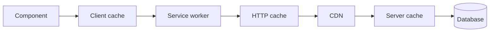
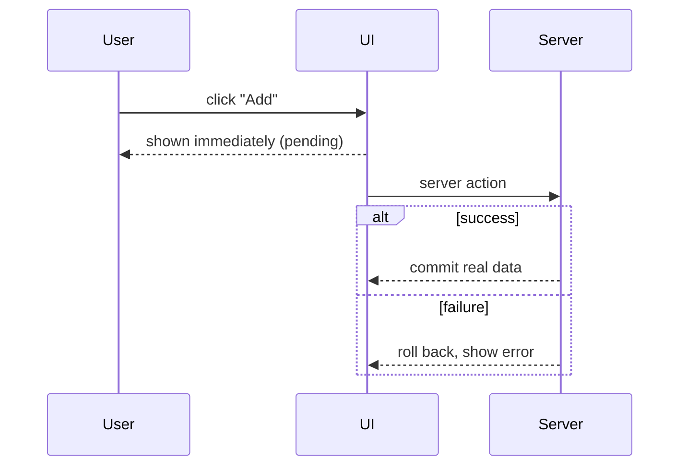
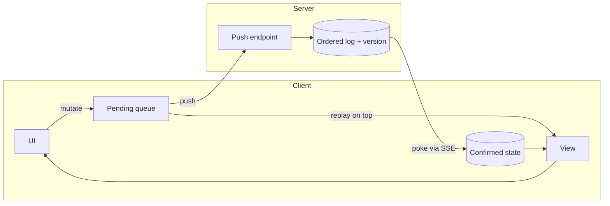

# Instant UI

## Techniques for web apps that feel instant

<div class="mt-12 text-xl muted">Cory House · github.com/coryhouse/instant-ui</div>

<!--
Welcome. Hour-long tour of 19 techniques, each with a live side-by-side demo: naive on the left, instant on the right.
Before starting: present from Chrome (not an embedded webview). `pnpm dev` running on :3000 (or `pnpm build && pnpm start` for prefetch/static numbers), latency slider at 1000ms, "Fail 50% of writes" OFF. For demo 14: `pnpm zero:up` and `pnpm zero:cache` already running.
-->

---
layout: center
class: text-center
---

# Speed is a feature

<v-clicks>

Users don't experience your architecture.

They experience **waiting**.

</v-clicks>

<!--
Nobody compliments a well-factored reducer. They notice when a button takes a beat to respond.
Goal today: a toolbox for removing, moving, or hiding that wait.
-->

---

# How fast is "instant"?

<div class="grid grid-cols-3 gap-8 mt-12 text-center">
<div v-click>
  <div class="big good">0.1s</div>
  <div class="mt-4">Feels <b>instant</b>.<br/>Direct manipulation.</div>
</div>
<div v-click>
  <div class="big warn">1s</div>
  <div class="mt-4">Keeps <b>flow</b>.<br/>User notices the delay.</div>
</div>
<div v-click>
  <div class="big bad">10s</div>
  <div class="mt-4">Loses <b>attention</b>.<br/>They switch tabs.</div>
</div>
</div>

<div v-click class="mt-12 text-center muted small">Jakob Nielsen's response-time limits (based on Robert Miller, 1968)</div>

<!--
These thresholds are decades old and haven't moved, because human perception hasn't moved.
100ms: feels like cause and effect. 1s: still in flow but you notice. 10s: you've lost them.
-->

---
layout: fact
---

# <span class="big accent">400ms</span>

The **Doherty threshold**: when a system responds in under 400ms, productivity soars, because neither the user nor the computer waits on the other.

<div class="small muted mt-6">Doherty & Thadani, IBM, 1982</div>

<!--
IBM found that when response time dropped under ~400ms, people worked dramatically faster. Not linearly faster: they stayed engaged.
The target is not "fast enough to finish", it's "fast enough that nobody waits".
-->

---

# Core Web Vitals

| Metric | Measures | Good |
| --- | --- | --- |
| **LCP** · Largest Contentful Paint | Loading: when the main content shows | <span class="good">≤ 2.5s</span> |
| **INP** · Interaction to Next Paint | Responsiveness: click → next frame | <span class="good">≤ 200ms</span> |
| **CLS** · Cumulative Layout Shift | Stability: does stuff jump around? | <span class="good">≤ 0.1</span> |

<div v-click class="mt-10">

Measured at the **75th percentile** of real users. Google uses them for ranking.

</div>

<!--
Three numbers: does it load, does it respond, does it stay put.
INP replaced FID in 2024; it measures every interaction, so main-thread work matters all session long.
p75 of real users: your M-series MacBook on office wifi is not the p75.
-->

---

# Every technique does one of four things

<div class="grid grid-cols-2 gap-6 mt-10">
  <div v-click class="box accent"><div class="text-3xl font-bold">Do less</div><div class="small mt-2">ship less code, render fewer nodes, skip repeated work</div></div>
  <div v-click class="box accent"><div class="text-3xl font-bold">Do it earlier</div><div class="small mt-2">build time, prefetch, cache, before the click</div></div>
  <div v-click class="box accent"><div class="text-3xl font-bold">Do it elsewhere</div><div class="small mt-2">CDN, service worker, web worker, local DB</div></div>
  <div v-click class="box accent"><div class="text-3xl font-bold">Hide the wait</div><div class="small mt-2">stream, skeletons, optimistic UI, transitions</div></div>
</div>

<!--
The mental model for the whole talk. For each technique, ask: which of the four is it?
The best ones combine two. Optimistic UI = hide the wait + do it later, elsewhere.
-->

---

# The plan: 19 demos, 6 sections

<div class="grid grid-cols-2 gap-x-12 gap-y-4 mt-8">

<div><b class="accent">1 · Render less, earlier</b><br/><span class="small">static · PPR · streaming</span></div>
<div><b class="accent">2 · Ship less</b><br/><span class="small">lazy loading · images · prefetch</span></div>
<div><b class="accent">3 · Cache everything</b><br/><span class="small">client · server · HTTP · service worker</span></div>
<div><b class="accent">4 · Don't wait for the server</b><br/><span class="small">optimistic · local-first · sync engines</span></div>
<div><b class="accent">5 · Keep the main thread free</b><br/><span class="small">memo · transitions · virtualization · workers</span></div>
<div><b class="accent">6 · Feel faster</b><br/><span class="small">view transitions</span></div>

</div>

<!--
Roughly in the order a request flows: server rendering, what we ship, caching, mutations, the main thread, perception.
-->

---

# How the demos work

<v-clicks>

- Every demo: **Naive** on the left, **Instant** on the right
- **Latency slider** in the header: simulated server delay (default 1000ms)
- **Fail 50% of writes**: test rollbacks
- Timing badges show *time to feedback*, not just time to done
- Page-load demos: **Reload both** reloads two iframes at the same moment

</v-clicks>

<div v-click class="mt-8"><DemoLink slug="" /></div>

<!--
DEMO CUE: show the home page. Point out the latency slider and the fail toggle in the header.
Everything runs locally and offline. The latency is fake but realistic: it's what your p75 mobile user lives with.
-->

---
layout: section
---

# 1 · Render less, earlier

<div class="muted">Static · Partial prerendering · Streaming</div>

<!--
What happens on the server before the first byte, and how to start sending bytes sooner.
-->

---

# Static rendering

<DemoLink slug="static" :n="1" corner />

<div class="grid grid-cols-2 gap-6 code-sm">
<div>
<div class="label-bad">Naive: render per request</div>

```tsx
export default async function Page() {
  await connection();   // opt in to per-request
  const products = await getProducts();
  return <ProductGrid products={products} />;
}
```

</div>
<div v-click>
<div class="label-good">Instant: render once</div>

```tsx
export default async function Page() {
  "use cache";
  cacheLife("days");
  const products = await getProducts();
  return <ProductGrid products={products} />;
}
```

</div>
</div>

<div v-click class="mt-6">Prerendered at build → served as a file from the CDN. <b>The fastest server is no server.</b></div>

<div v-click class="not-for mt-6 small"><b>Not for:</b> per-user content, data that must be fresh to the second.</div>

<!--
Do it earlier: at build time. With Cache Components, "use cache" makes the output static; awaiting connection() (or uncached data) makes it dynamic. cacheLife sets how stale it may get.
DEMO CUE: set latency to 2000ms, click "Reload both". Point at "Rendered at": the prerendered page doesn't change, the dynamic page does every reload.
Dev renders everything on demand; for real numbers use `pnpm build && pnpm start`.
-->

---

# Partial prerendering

**Problem:** one personalized widget makes the *whole page* dynamic.

<div class="grid grid-cols-3 gap-4 mt-10 text-center">
  <div class="box good col-span-3">Header · product info <span class="small muted">(static shell, sent immediately)</span></div>
  <div class="box bad" v-click>Cart count<br/><span class="small">cookie → streams in</span></div>
  <div class="box bad" v-click>Live stock<br/><span class="small">per request → streams in</span></div>
  <div class="box bad" v-click>Recommendations<br/><span class="small">personal → streams in</span></div>
</div>

<div v-click class="mt-10 text-center">The shell ships <b>instantly</b>. Dynamic holes stream into the same response.</div>

<!--
PPR = static and dynamic in one route. The prerendered shell goes out immediately, Suspense boundaries mark the holes, and the server fills them in over the same HTTP response.
In Next 16 with cacheComponents this is the default model.
-->

---

# PPR: the code is just Suspense

<DemoLink slug="ppr" :n="2" corner />

```tsx {2-3|4-9|12-16|all}
export default function Page() {
  return (<>
    <StoreHeader cart={<Suspense fallback={<Dot />}><Cart /></Suspense>} />
    <CachedProductInfo />
    <Suspense fallback={<LiveStockSkeleton />}><Stock /></Suspense>
    <Suspense fallback={<RecsSkeleton />}><PersonalRecs /></Suspense>
  </>);
}

// Static: same for everyone → prerendered into the shell
async function CachedProductInfo() {
  "use cache";
  cacheLife("hours");
  return <ProductInfo product={await getProduct(PRODUCT_ID)} />;
}
```

<div v-click class="not-for mt-4 small"><b>Watch out:</b> skeletons that shift layout (CLS), too many tiny holes = popcorn UI.</div>

<!--
No special API. The Suspense boundary is the line between static and dynamic. Cart reads cookies(), stock calls connection(): those become holes.
DEMO CUE: latency 2000ms, "Reload both". Naive: blank until everything arrives (~3s). Instant: header + product immediately, then stock, then recs. The instant "shell" badge doesn't depend on latency at all.
-->

---

# Streaming: kill the waterfall

<div class="grid grid-cols-2 gap-10 mt-6">
<div>

**Naive:** sequential awaits

<div class="timeline">
  <div class="tl-row"><span class="tl-label">product</span><div class="tl-track"><div class="tl-bar" style="left:0.0000%"></div></div></div>
  <div class="tl-row"><span class="tl-label">reviews</span><div class="tl-track"><div class="tl-bar" style="left:33.3333%"></div></div></div>
  <div class="tl-row"><span class="tl-label">recs</span><div class="tl-track"><div class="tl-bar" style="left:66.6667%"></div></div></div>
  <div class="tl-row"><span class="tl-label"></span><div class="tl-axis"><span>0s</span><span>1s</span><span>2s</span><span>3s</span></div></div>
</div>

</div>
<div v-click>

**Instant:** parallel + stream

<div class="timeline">
  <div class="tl-row"><span class="tl-label">product</span><div class="tl-track"><div class="tl-bar" style="left:0.0000%"></div></div></div>
  <div class="tl-row"><span class="tl-label">reviews</span><div class="tl-track"><div class="tl-bar" style="left:0.0000%"></div></div></div>
  <div class="tl-row"><span class="tl-label">recs</span><div class="tl-track"><div class="tl-bar" style="left:0.0000%"></div></div></div>
  <div class="tl-row"><span class="tl-label"></span><div class="tl-axis"><span>0s</span><span>1s</span><span>2s</span><span>3s</span></div></div>
</div>

</div>
</div>

<div v-click class="mt-4 text-center">Total time: <b class="bad">sum</b> of queries → <b class="good">slowest</b> query</div>

<!--
Waterfalls are the #1 server-side perf bug I see. Each await waits for the previous one even when they're independent.
Fix: start everything at once, and stream each piece as it resolves.
-->

---

# Streaming: the code

<DemoLink slug="streaming" :n="3" corner />

<div class="grid grid-cols-2 gap-6 code-sm">
<div>
<div class="label-bad">Naive: waterfall</div>

```tsx
// total = product + reviews + recs
export default async function Page() {
  const product = await fetchProduct();
  const reviews = await fetchReviews();
  const recs = await fetchRecs();
  return (<>
    <ProductSection product={product} />
    <ReviewsSection reviews={reviews} />
    <RecsSection products={recs} />
  </>);
}
```

</div>
<div v-click>
<div class="label-good">Instant: parallel + Suspense</div>

```tsx
// total = slowest; each pops in when ready
export default function Page() {
  const product = fetchProduct();   // no await
  const reviews = fetchReviews();
  const recs = fetchRecs();
  return (<>
    <Suspense fallback={<ProductSkeleton />}>
      <Product data={product} />
    </Suspense>
    {/* … reviews, recs the same */}
  </>);
}
```

</div>
</div>

<div v-click class="not-for mt-4 small"><b>Watch out:</b> a fetching parent above nested Suspense re-creates the waterfall. Status code is sent before holes resolve.</div>

<!--
Start the promises at the top without awaiting, pass them down, await inside each Suspense boundary.
DEMO CUE: latency 2000ms, "Reload both". Naive: one spinner (loading.tsx), then everything at ~3x latency. Instant: skeletons, each section pops in on its own. Compare the recs badges. Drag the latency slider to update the expected timeline below.
-->

---
layout: section
---

# 2 · Ship less

<div class="muted">Lazy loading · Images · Prefetch</div>

<!--
Now the client side: the bytes you send, and when you send them.
-->

---

# Lazy loading

<DemoLink slug="lazy" :n="4" corner />

**Problem:** the editor and its 1 MB dictionary ship to everyone, up front.

```tsx {1-5|8-10|all}
const loadEditor = () => import("../heavy/HeavyEditor");
const HeavyEditor = dynamic(loadEditor, {
  ssr: false,
  loading: () => <div className="skeleton h-32 w-full" />,
});

// …
<button onMouseEnter={() => void loadEditor()}  // start early on intent
        onClick={() => setOpen(true)}>Open editor</button>
{open && <HeavyEditor />}

   // below the fold: fetch near viewport
```

<div v-click class="not-for mt-2 small"><b>Not for:</b> above-the-fold or always-used components; tiny modules.</div>

<!--
Do less, up front. Every KB of JS is downloaded, parsed, compiled, executed: main-thread time before interactive.
Hover preloading hides the lazy chunk's own delay.
DEMO CUE: "Reload both", compare JavaScript and Image bytes before touching anything. In Instant, click "Open editor": JavaScript jumps as the chunk loads. Scroll down: images load as they approach the viewport. Dev bundles are bigger than prod; the difference is what matters.
-->

---

# Image optimization

<DemoLink slug="images" :n="5" corner />

**Problem:** images are usually the LCP element *and* the biggest bytes.

```tsx {1|2|3|4|all}
<Image src={hero}            // static import → known size: no CLS
  sizes="100vw"              // srcset: right size per viewport
  preload                    // LCP image: fetch it first
  placeholder="blur"         // something to look at immediately
  alt="Hero" />

{gallery.map((photo, i) =>   // lazy by default, WebP/AVIF
  <Image key={i} src={photo} sizes="50vw" placeholder="blur" alt="" />)}
```

<div v-click class="not-for mt-2 small"><b>Watch out:</b> preload only the 1–2 LCP images; never lazy-load the LCP image.</div>

<!--
Right size, right format, right priority. In Next 16 `priority` is deprecated in favor of `preload`.
DEMO CUE (Chrome, for the LCP/CLS readouts): "Reload both". Both frames get the same simulated ~40 Mbps connection. Naive: ~15 MB of PNGs, the heading jumps down as images arrive (CLS), the hero fights the gallery for bandwidth (slow LCP). Instant: a few hundred KB, blur placeholders hold space, nothing moves. Right-click an Instant image → Open in new tab: a resized WebP, not the 2400px original.
-->

---

# Prefetch & preload

<DemoLink slug="prefetch" :n="6" corner />

```tsx {1-2|4-5|7-12|all}
// Default: prefetches the route's App Shell when visible (prod)
<Link href={`/products/${id}`}>{name}</Link>

// Also prefetch this link's cached data (prod)
<Link href={`/products/${id}`} prefetch>{name}</Link>

// On intent: route + data into a client cache (works in dev)
function onIntent() {
  router.prefetch(href);
  primeProduct(id);   // fetch(`/api/prefetch/product/${id}`)
}
<Link href={href} onMouseEnter={onIntent} onFocus={onIntent}>…</Link>
```

<div v-click class="small mt-2">No framework? <code>&lt;script type="speculationrules"&gt;</code> prerenders plain <code>&lt;a&gt;</code> links on hover (Chromium).</div>

<!--
Do it earlier. The gap between hover and click is often 200ms+: free time.
DEMO CUE: click a product in each frame; the big timer badge shows click → product visible. Naive (prefetch={false}): nothing happens for a full round trip. Instant: switches immediately with a skeleton. Hover a "Hover prefetch" link, wait for "data cached", then click: 0ms (works in dev).
Next doesn't prefetch in dev: run `pnpm build && pnpm start` for the first two groups. Optional: /frame/prefetch/mpa for Speculation Rules (Chrome; DevTools → Application → Speculative loads).
Watch out: wasted bandwidth on links nobody clicks; respect Save-Data.
-->

---
layout: section
---

# 3 · Cache everything



<!--
The fastest request is the one you don't make. Each layer short-circuits everything to its right. We'll demo four: client, server, HTTP, service worker.
-->

---

# Client cache: stale-while-revalidate

<DemoLink slug="caching/client" :n="7" corner />

<div class="grid grid-cols-2 gap-6 code-sm">
<div>
<div class="label-bad">Naive: useEffect + fetch</div>

```tsx
function useFetch<T>(url: string | null) {
  const [state, setState] = useState(null);
  useEffect(() => {
    if (!url) return;
    let cancelled = false;
    getJson<T>(url).then((data) =>
      !cancelled && setState({ url, data }));
    return () => { cancelled = true; };
  }, [url]);
  return state?.url === url ? state.data : undefined;
}
```

</div>
<div v-click>
<div class="label-good">Instant: TanStack Query</div>

```tsx
const productsQuery = (category: string) =>
  queryOptions({
    queryKey: ["products", category],
    queryFn: () => getJson(productsUrl(category)),
  });

const list = useQuery({ ...productsQuery(category), staleTime });

// Prefetch on hover
onHoverCategory={(c) =>
  queryClient.prefetchQuery(productsQuery(c))}
```

</div>
</div>

<div v-click class="not-for mt-4 small"><b>Not for:</b> data where stale is dangerous (balances, checkout stock). Invalidate after mutations.</div>

<!--
Show cached data now, fix it up when the network answers. The cache is persisted to localStorage, so even a full reload is instant.
DEMO CUE: latency 2000ms. Click through categories and products on both sides, then go back to one you've seen: naive spins every time, cached is ~16ms with "refreshing…". Hover a category on the right before clicking: even first visits are instant. Reload the page: "page load → data" is near-instant (persisted). Set staleTime to 10s: no refetch at all. "Clear cache" resets.
-->

---

# Server cache: `use cache` + tags

<DemoLink slug="caching/server" :n="8" corner />

<div class="code-md">

```ts {1-7|9-13|15-19|all}
async function getInventory() {
  "use cache";
  cacheTag("products");
  cacheLife("hours");
  const items = await readInventory();   // slow query runs once
  return { items, computedAt: new Date().toLocaleTimeString() };
}

export async function sellWithUpdateTag() {   // "use server"
  sellOne(1);
  updateTag("products");   // read-your-own-writes: wait for fresh data
}

export async function sellWithRevalidateTag() {
  sellOne(1);
  revalidateTag("products", "max");  // SWR: next visitor gets stale value now
}
```

</div>

<!--
Compute once, invalidate precisely. updateTag only works in Server Actions.
DEMO CUE: "Reload both" a few times: naive shows a skeleton for the full latency every time; cached is instant and "Computed at" doesn't change.
Click "Sell 1 keyboard → updateTag": waits for fresh data, shows new stock. Click "Sell 1 keyboard → revalidateTag("max")": returns instantly; "Reload this frame" shows OLD stock (compare "Database right now"); reload again after the latency: fresh.
Watch out: never cache per-user data under a shared key; forget a tag = stale forever.
-->

---

# HTTP cache

<DemoLink slug="caching/http" :n="9" corner />

```ts {4|5|6-8|all}
// app/api/caching/http/max-age/route.ts
export async function GET() {
  await connection();
  await delay();
  return Response.json(payload("max-age"), {
    headers: {
      "Cache-Control": "public, max-age=10, stale-while-revalidate=60",
    },
  });
}
```

<v-clicks>

- `max-age=10`: fresh for 10s, **zero requests**
- `stale-while-revalidate=60`: serve stale instantly, refresh in background
- `ETag`: still a round trip, but a cheap **304** with no body

</v-clicks>

<!--
The oldest cache and still the best. Zero JavaScript. CDNs honor s-maxage the same way, shared across users.
DEMO CUE: DevTools "Disable cache" must be OFF. Click each button a few times: no-store pays full latency every time; max-age is ~0ms after the first click and the server counter stops moving. Wait 10s, click max-age: still instant, but the counter goes up (background refresh). ETag panel: round trip, 304, slow work skipped.
Watch out: you can't purge a browser cache; never `public` on per-user responses.
-->

---

# Service worker cache

<DemoLink slug="caching/sw" :n="10" corner />

```js {1-3|4-11|12-15|all}
async function staleWhileRevalidate(event) {
  const cache = await caches.open(CACHE);
  const cached = await cache.match(event.request);
  const network = fetch(event.request).then(async (res) => {
    if (res.ok) await cache.put(event.request, res.clone());
    return res;
  });

  if (cached) {
    event.waitUntil(network.catch(() => {})); // offline? keep cached copy
    return cached;
  }
  return network;
}
```

<div v-click class="not-for mt-2 small"><b>Watch out:</b> updates (users stuck on old versions), hard to debug. Consider Workbox / Serwist.</div>

<!--
A programmable proxy in the browser, on its own thread. Registered with scope /caching/sw and only touches two path prefixes.
DEMO CUE (needs real Chrome; embedded webviews may refuse SW registration): click "Register SW". If "Controls this page" says no, do a normal reload. Click both GET buttons twice: SW panel misses the first time, then ~0ms. DevTools → Network → Offline, click both again: network-only fails, SW panel still shows data. Turn Offline back OFF, then "Unregister + clear cache".
-->

---
layout: section
---

# 4 · Don't wait for the server

<div class="muted">Optimistic UI · Local-first · Sync engines</div>

<!--
Everything so far was about reads. Now writes. This is where apps like Linear feel magical.
-->

---

# Optimistic UI



<!--
Hide the wait. Assume success, because most writes succeed, show it now, reconcile when the server answers. The important part is the failure path.
-->

---

# Optimistic UI: `useOptimistic`

<DemoLink slug="optimistic" :n="11" corner />

```tsx {1-2|4-12|all}
const [todos, setTodos] = useState<TodoView[]>(initial);
const [optimisticTodos, addOptimistic] = useOptimistic(todos, applyOptimistic);

function handleAdd(text: string) {
  startTransition(async () => {
    const temp = { id: `temp-${crypto.randomUUID()}`, text, pending: true };
    addOptimistic({ type: "add", todo: temp });
    const res = await addTodoAction(text);
    if (res.ok) startTransition(() => setTodos((ts) => [...ts, res.value]));
    else setError(`Rolled back: ${res.error}`);   // optimistic state just drops
  });
}
```

<div v-click class="not-for mt-4 small"><b>Not for:</b> payments, irreversible actions, writes that fail often.</div>

<!--
Optimistic state lives only while the transition runs. On success we commit real data; on failure React drops the optimistic state: automatic rollback.
DEMO CUE: latency 2000ms. Add a todo on each side: left spins 2s, right is instant (faded = pending). Rapid-fire toggle checkboxes: left locks up after every click. Turn ON "Fail 50% of writes", add a few on the right: failed ones vanish with an error. Turn it OFF.
-->

---

# Local-first

<DemoLink slug="local-first" :n="12" corner />

<div class="grid grid-cols-2 gap-6 code-sm">
<div>
<div class="label-good">Reads & writes: local, ~1ms</div>

```ts
db.version(1).stores({
  todos: "id, createdAt, dirty", meta: "key" });

const todos = useLiveQuery(() =>
  db.todos.orderBy("createdAt")
    .filter((t) => !t.deleted).toArray());

await db.todos.add({ id, text, done: false,
  updatedAt: Date.now(), dirty: 1 }); // outbox
```

</div>
<div v-click>
<div class="label-good">Sync: in the background</div>

```ts
export async function syncOnce() {
  const outbox = await db.todos
    .where("dirty").equals(1).toArray();
  const since = (await db.meta.get("version"))?.value ?? 0;
  const res = await lfFetch("/api/local-first/sync", {
    method: "POST",
    body: JSON.stringify({ changes: outbox, since }),
  });
  // mark pushed rows clean; apply remote changes
  // (last-write-wins by updatedAt)
}
```

</div>
</div>

<div v-click class="not-for mt-4 small"><b>Hard parts:</b> initial sync size, conflicts, auth, migrations. That's why sync engines exist.</div>

<!--
The local database (IndexedDB via Dexie) is the source of truth. dirty: 1 rows ARE the outbox. Sync runs on mount, every 3s, and on reconnect.
DEMO CUE: latency 2000ms. Add/toggle on both sides: left waits, right is instant. Turn on "Simulate offline": left breaks, right keeps working and the outbox count climbs. Turn offline off: outbox drains; "Reload from server" on the left shows the synced changes. Hard-reload: right renders from IndexedDB immediately.
-->

---

# How a sync engine works



<v-clicks>

1. Mutations apply locally **and** go into a queue
2. Server applies them in order → authoritative version
3. Clients get poked, **rebase** pending mutations on top

</v-clicks>

<!--
The architecture behind Linear, Figma, Replicache, Zero.
Rebase is the key idea: like git. Take the server state, re-apply my unconfirmed mutations on top. If the server rejected one, it simply disappears.
-->

---

# Rebase, by hand

<DemoLink slug="sync/hand-rolled" :n="13" corner />

```ts {1-6|8-14|16|all}
/** 1) apply locally (instant)  2) queue  3) push in the background. */
mutate(m: Mutation) {
  const pm = { ...m, clientId: this.clientId, seq: ++this.seq };
  this.pending.push(pm);
  void this.flush();
}

/** The server says "this is the truth at version N". Rebase on top of it. */
private onPoke(poke: Poke) {
  this.confirmed = poke.todos;
  const last = poke.lastSeq[this.clientId] ?? 0;
  this.pending = this.pending.filter((m) => m.seq > last); // drop confirmed/rejected
  this.emit();
}

todos: this.pending.reduce(applyMutation, this.confirmed), // ← the rebase
```

<!--
applyMutation is a pure function both sides run: client to predict, server to decide.
DEMO CUE: open the page in a SECOND Chrome window, side by side. Works best with low latency and few tabs open (SSE uses one connection per tab). Toggle on the right panel: instant here, appears in the other window when the server confirms. Watch the polling panel lag (data age climbs). Latency 2000ms, click quickly: mutations stack up as pending, confirm in order in the sync log. Turn ON "Fail 50% of writes": rejected mutations roll back everywhere (✗ in the log). Turn it OFF.
Why not hand-roll in prod: partial sync, permissions, reconnection, log GC.
-->

---

# Production sync: Zero

<DemoLink slug="sync/zero" :n="14" corner />

<div class="grid grid-cols-2 gap-6 code-sm">
<div>
<div class="label-good">Queries: run on the local replica</div>

```ts
export const queries = defineQueries({
  todos: {
    list: defineQuery(validator(isFilter),
      ({ args: { filter } }) => {
        let q = zql.todo.orderBy("created_at", "asc");
        if (filter !== "all")
          q = q.where("done", filter === "done");
        return q;
      }),
  },
});

const [todos] = useQuery(queries.todos.list({ filter }));
```

</div>
<div v-click>
<div class="label-good">Mutators: run on client AND server</div>

```ts
export const mutators = defineMutators({
  todo: {
    toggle: defineMutator(validator(isToggle),
      async ({ tx, args }) => {
        await tx.mutate.todo.update(
          { id: args.id, done: args.done });
      }),
    // add, remove …
  },
});

zero.mutate(mutators.todo.toggle({ id, done }))
  .server.then((r) => r.type === "error" && rollbackMsg(r));
```

</div>
</div>

<!--
Rocicorp Zero: Postgres is the source of truth, zero-cache replicates to clients' local replicas. The SAME mutator runs in the browser (same frame) and on our /api/zero/mutate endpoint against Postgres. If the server run fails, Zero rolls back.
DEMO CUE: needs `pnpm zero:up` and `pnpm zero:cache` started before the talk (~25s to be ready). Latency 2000ms: add/toggle in both panels; Zero updates in ~1 frame, "awaiting server…" shows Postgres catching up. Click All / Open / Done: Zero filters instantly, fetch waits. Toggle in Zero: the second client updates live. Fail 50% of writes ON: rejected writes roll back. Optional: stop zero-cache, status pill flips, local reads still work.
Tradeoffs: another service to run, Postgres + logical replication required.
-->

---

# The sync engine landscape

| Tool | Source of truth | Model | Notes |
| --- | --- | --- | --- |
| **Zero** | Postgres | Partial replica + ZQL | Queries run locally and on server |
| **ElectricSQL** | Postgres | Read-path sync (shapes) | Bring your own writes |
| **InstantDB** | Hosted | Relational + realtime | Firebase-like DX |
| **Convex** | Hosted | Reactive server functions | Server-first, live queries |
| **Replicache** | Your backend | Push/pull + rebase | Zero's predecessor; now open source |
| **TanStack DB** | Your API | Client collections + optimistic | Pairs with TanStack Query |
| **Yjs / Automerge** | Peers | CRDTs | Collaborative text, offline merge |

<!--
Two families: server-authoritative with rebase (Zero, Replicache, Convex, Instant) vs CRDTs (Yjs, Automerge) that merge without a central authority, great for collaborative documents.
Pick based on where your data lives today and whether you need offline multi-writer merges.
-->

---

# When is sync worth it?

<div class="grid grid-cols-2 gap-10 mt-8">
<div>

**Great fit**

- Highly interactive, data-heavy apps
- Collaboration / multi-device
- Offline or flaky networks
- Productivity tools (think Linear)

</div>
<div class="not-for">

**Poor fit**

- Content sites, mostly-read pages
- Huge or highly sensitive datasets
- Simple CRUD with rare writes
- Teams without appetite for new infra

</div>
</div>

<!--
Sync engines are the biggest lever in this talk and the biggest commitment. Optimistic UI gets you most of the way for simple forms.
-->

---
layout: section
---

# 5 · Keep the main thread free

<div class="muted">Memoization · Transitions · Virtualization · Web workers</div>

<!--
INP territory. One main thread runs your JS, layout, paint, and input handling. A 300ms task means a 300ms frozen UI.
-->

---

# Memoization

<DemoLink slug="memo" :n="15" corner />

<div class="grid grid-cols-2 gap-6 code-sm">
<div>
<div class="label-good">Manual: all three pieces required</div>

```tsx
const MemoSlowList = memo(SlowList);

export function ManualPanel() {
  "use no memo";   // compiler opted out
  // …
  const items = useMemo(() => sortItems(ITEMS, sort), [sort]);
  const onSelect = useCallback((id) => setSelectedId(id), []);
  return <MemoSlowList items={items}
    selectedId={selectedId} onSelect={onSelect} />;
}
```

</div>
<div v-click>
<div class="label-good">React Compiler: plain code</div>

```tsx
// reactCompiler: true in next.config.ts
export function CompilerPanel() {
  // …
  const items = sortItems(ITEMS, sort);
  const onSelect = (id) => setSelectedId(id);
  return <SlowList items={items}
    selectedId={selectedId} onSelect={onSelect} />;
}
// Naive = this exact code + "use no memo"
```

</div>
</div>

<div v-click class="not-for mt-4 small"><b>Remember:</b> memo skips work; it doesn't make work faster. Profile first.</div>

<!--
Do less: skip work you've already done. The compiler caches items, onSelect and the SlowList element automatically.
DEMO CUE: type quickly in the Naive input: characters lag, SlowList's render counter climbs every keystroke. Type in Manual and Compiler: parent counter climbs, SlowList's stays put. Click Sort or a row in any panel: all three are equally slow, because SlowList must re-render.
-->

---

# Transitions

<DemoLink slug="transitions" :n="16" corner />

```tsx {2|3|8-10|all}
export function DeferredSearch() {
  const [query, setQuery] = useState("");
  const deferredQuery = useDeferredValue(query);
  const isStale = query !== deferredQuery;
  return (
    <>
      <SearchInput value={query} onChange={setQuery} />   {/* urgent */}
      <div className={isStale ? "opacity-50" : ""}>
        <SlowResults query={deferredQuery} />            {/* interruptible */}
      </div>
    </>
  );
}
```

<div v-click class="not-for mt-2 small"><b>Not a fix for:</b> one long synchronous loop (→ workers) or too many DOM nodes (→ virtualization).</div>

<!--
React paints the keystroke first, then renders the list in the background, yielding to new keystrokes and discarding stale renders. useTransition/startTransition is the same idea when you own the setState.
Deferring only helps if the list can skip re-rendering for an unchanged value: the compiler memoizes SlowResults here.
DEMO CUE: type "swift otter" quickly in the Naive box: letters appear in bursts, input latency 200ms+. Same in Instant: every letter immediate, list dims while catching up. Hold Backspace in each and watch the frame graph.
-->

---

# Virtualization

<DemoLink slug="virtualization" :n="17" corner />

<div class="grid grid-cols-[3fr_2fr] gap-10">
<div class="code-md">

```tsx {1-6|8-13|all}
const virtualizer = useVirtualizer({
  count: rows.length,
  getScrollElement: () => ref.current,
  estimateSize: () => ROW_HEIGHT,
  overscan: 5,
});

<div ref={ref} className="h-96 overflow-y-auto">
  <div style={{ height: virtualizer.getTotalSize() }}>
    {virtualizer.getVirtualItems().map((item) =>
      <RowView key={item.key} … />)}
  </div>
</div>
```

</div>
<div v-click>

**~80,000 DOM nodes → ~150**

Render only what's on screen, plus overscan. Cost is constant, whatever the row count.

<div class="not-for small mt-6"><b>Watch out:</b> Ctrl+F, a11y and SEO can't see off-screen rows. Variable heights need measuring.</div>

</div>
</div>

<!--
Do less: fewer DOM nodes = faster render, layout, memory. Note "use no memo" in the real file: useVirtualizer returns a mutable object the compiler can't track.
DEMO CUE: click "Mount list" on the left: spinner freezes while ~80,000 DOM nodes are created; note the mount time. "Mount list" on the right: a few ms, ~150 nodes. Scroll both; the right's node count stays flat. Switch to 50,000 rows and repeat.
-->

---

# Web workers

<DemoLink slug="workers" :n="18" corner />

<div class="grid grid-cols-2 gap-6 code-sm">
<div>
<div class="label-good">primes.worker.ts: another thread</div>

```ts
self.onmessage = (e: MessageEvent<number>) => {
  const limit = e.data;
  const start = performance.now();
  const count = countPrimes(limit);  // blocks
  self.postMessage({                 // this thread only
    limit, count,
    ms: Math.round(performance.now() - start),
  });
};
```

</div>
<div v-click>
<div class="label-good">Component: post and stay free</div>

```tsx
useEffect(() => {
  const w = new Worker(
    new URL("./primes.worker.ts", import.meta.url),
    { type: "module" });
  w.onmessage = (e) => { setResult(e.data); setBusy(false); };
  worker.current = w;
  return () => w.terminate();
}, []);

function run() {
  setBusy(true);
  worker.current?.postMessage(limit);
}
```

</div>
</div>

<div v-click class="not-for mt-4 small"><b>Watch out:</b> data is copied (structured clone), no DOM access, overkill for &lt;50ms tasks.</div>

<!--
Do it elsewhere. Parsing, image processing, search indexing: none of it needs the DOM. Comlink makes it feel like async calls.
DEMO CUE: click "Count primes" on the left, then immediately try typing or clicking +1: spinner and FPS freeze, then everything lands at once. Same on the right: spinner keeps spinning at 60fps, you can type the whole time. Compare durations: the worker isn't faster, it just isn't in the way.
-->

---

# 6 · Feel faster: view transitions

<DemoLink slug="view-transitions" :n="19" corner />

```tsx {1|3-7|9-13|all}
const select = (id: string | null) => startTransition(() => setSelectedId(id));

// Grid: each thumbnail gets a unique name
<ViewTransition name={`vt-card-${c.id}`} share="vt-morph" default="none">
  <div><Thumb card={c} /></div>
</ViewTransition>

// Detail: same name → the browser morphs one into the other
<ViewTransition name={`vt-card-${card.id}`} share="vt-morph" default="none">
  <div><Thumb card={card} size="lg" /></div>
</ViewTransition>
<ViewTransition enter="vt-slide-up" exit="vt-slide-down">…</ViewTransition>
```

<div v-click class="not-for mt-2 small"><b>Watch out:</b> keep it 150–300ms, respect <code>prefers-reduced-motion</code>. Animation decorates a fast page; it doesn't fix a slow one.</div>

<!--
Perception: continuity. React's <ViewTransition> activates on transitions (startTransition, Link navigations, Suspense reveals) and drives the browser's View Transitions API.
DEMO CUE: click a card on the left, then the same card on the right. Both instant; only the right shows where the card went. Filter and reverse both lists: left pops, right slides. Click a card in the page navigation strip: morphs into the next page's hero, facts slide in when loaded (raise latency to see the skeleton). Ask the audience which "felt" faster.
-->

---

# Bottleneck → technique

<div class="compact-table">

| If the bottleneck is… | Reach for |
| --- | --- |
| Slow server / data | Static, server cache, streaming, PPR |
| Big bundle | Lazy loading, Server Components |
| Heavy images / LCP | Image optimization, preload |
| Slow network | Prefetch, HTTP cache, service worker |
| Repeat visits | Client cache (SWR), HTTP cache, SW |
| Slow mutations | Optimistic UI → local-first → sync engine |
| Janky interactions | Transitions, memo, virtualization, workers |
| Abrupt changes | Skeletons, view transitions |

</div>

<!--
Diagnose first, then pick the matching technique. Applying them all blindly just adds complexity.
-->

---

# Measure first

<div class="grid grid-cols-2 gap-10 mt-8">
<div>

**Lab**

- **Lighthouse**: LCP, CLS, bundle hints
- **Performance panel**: long tasks, waterfalls, INP
- **React DevTools Profiler**: why did this render?
- **Network panel**: throttling, cache hits

</div>
<div v-click>

**Field (what users really feel)**

- `web-vitals` library → your analytics
- Chrome UX Report (CrUX), Search Console
- Next.js `useReportWebVitals`
- Always look at **p75**, on **mobile**

</div>
</div>

<!--
Lab tools tell you why; field data tells you whether it matters. Throttle CPU and network in DevTools: your laptop lies to you.
-->

---
layout: center
class: text-center
---

# Do less · Do it earlier · Do it elsewhere · Hide the wait

<div v-click class="mt-10 text-2xl">

The goal isn't fast. It's **instant**: the user never waits on you.

</div>

<!--
Recap the four moves. Every one of the 19 demos was one or two of these.
-->

---

# Resources

- **Demos & slides:** [github.com/coryhouse/instant-ui](https://github.com/coryhouse/instant-ui)
- Next.js Cache Components, PPR, streaming: [nextjs.org/docs](https://nextjs.org/docs)
- React: [react.dev](https://react.dev) (useOptimistic, useDeferredValue, ViewTransition)
- Core Web Vitals: [web.dev/vitals](https://web.dev/vitals)
- TanStack Query & Virtual: [tanstack.com](https://tanstack.com)
- Local-first: [localfirstweb.dev](https://localfirstweb.dev) · Zero: [zero.rocicorp.dev](https://zero.rocicorp.dev)
- Dexie: [dexie.org](https://dexie.org)

<!--
Everything you saw today is in the repo, including these slides. Clone it, move the latency slider, break things.
-->

---
layout: end
---

# Thank you!

Cory House · github.com/coryhouse/instant-ui

<!--
Questions.
-->
